<!-- ============================================================
     Profile README — github.com/batuuhnk
     All visuals live in /assets as animated SVGs.
     ============================================================ -->

<p align="center">
  
</p>

<p align="center">
  <a href="https://www.linkedin.com/in/batuhankilicli"></a>
  <a href="mailto:batuhankilicli@gmail.com"></a>
  
</p>

<br />

<!-- ====================== 01 · ABOUT ====================== -->


I'm an embedded software engineer with **7 years** of hands-on experience building firmware for **defense and avionics** systems — from bare-metal drivers and BSPs up to RTOS architectures, sensor fusion and the test tooling that proves it all works in the field.

```c
const engineer_t batuhan = {
    .role        = "Embedded Software Engineer",
    .domain      = { "Defense", "Avionics", "Navigation" },
    .platforms   = { "STM32", "ARM Cortex-M", "TI TMS" },
    .rtos        = "FreeRTOS / CMSIS-RTOS v2",
    .specialties = { "Sensor fusion", "DSP filtering", "Real-time DAQ", "Driver & BSP design" },
    .process     = { "DO-178C", "V-Model", "HIL / SIL testing" },
    .exploring   = "PX4 flight stack",
};
```

> Most of my professional code ships inside certified products and can't be published — the repositories here are personal work and learning projects.

<br />

<!-- ====================== 02 · WHAT I BUILD ====================== -->

<p align="center">
  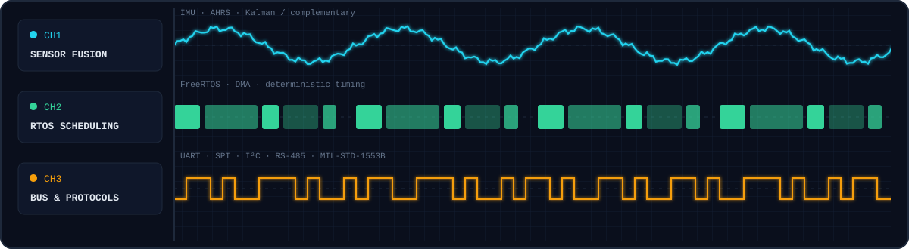
</p>

<table>
  <tr>
    <td width="33%" valign="top">
      <h4>🧭 Navigation &amp; sensing</h4>
      Inertial sensing and sensor fusion: Kalman and complementary filters, sensor calibration and digital filtering pipelines.
    </td>
    <td width="33%" valign="top">
      <h4>⏱️ Real-time architecture</h4>
      FreeRTOS task design, DMA-driven acquisition, deterministic timing, error logging and Built-In Test (BIT).
    </td>
    <td width="33%" valign="top">
      <h4>🧪 Verification &amp; tooling</h4>
      Requirements-based testing, HIL / SIL rigs, Qt test and calibration tools, DO-178C-style traceability.
    </td>
  </tr>
</table>

<br />

<!-- ====================== 03 · TECH STACK ====================== -->

<table>
  <tr>
    <td><b>Languages</b></td>
    <td>   </td>
  </tr>
  <tr>
    <td><b>MCU &amp; RTOS</b></td>
    <td>    </td>
  </tr>
  <tr>
    <td><b>Buses</b></td>
    <td>    </td>
  </tr>
  <tr>
    <td><b>Tools</b></td>
    <td>   </td>
  </tr>
  <tr>
    <td><b>Process</b></td>
    <td>  </td>
  </tr>
</table>

<br />

<!-- ====================== 04 · FEATURED WORK ====================== -->

<p align="center">
  <a href="https://github.com/batuuhnk/px4-sitl-learning">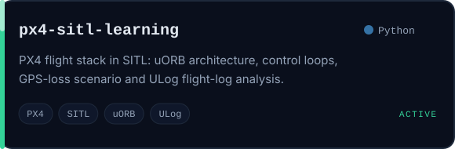</a>
  <a href="https://github.com/batuuhnk/cpp-temelleri">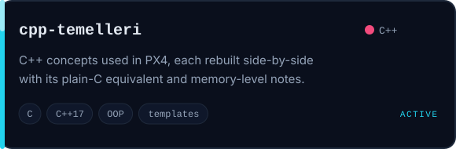</a>
</p>
<p align="center">
  <a href="https://github.com/batuuhnk/embedded-handbook">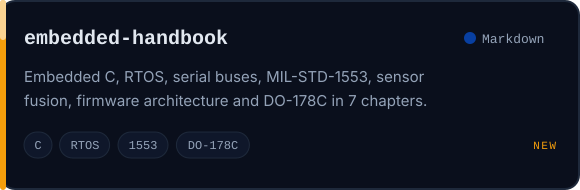</a>
  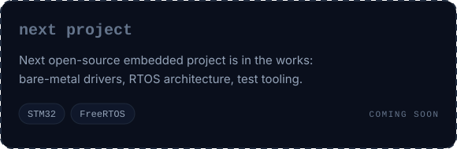
</p>

<!-- To add a project: copy a card SVG in /assets, edit its text, and add an <a></a> line above. -->

<br />

<!-- ====================== 05 · CURRENTLY ====================== -->


- 🛩️ &nbsp;Studying the **PX4 flight stack** in simulation — uORB, estimators, control loops and failure scenarios
- 🔧 &nbsp;Bridging **C → modern C++** for flight-software codebases

<br />

<!-- ====================== 06 · CONTACT ====================== -->

Open to conversations about **embedded systems, navigation and avionics software**. The fastest way to reach me is [LinkedIn](https://www.linkedin.com/in/batuhankilicli) or [email](mailto:batuhankilicli@gmail.com).

<p align="center">
  
</p>
