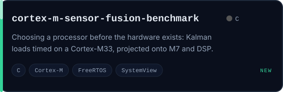
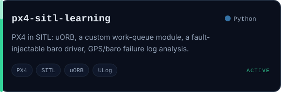
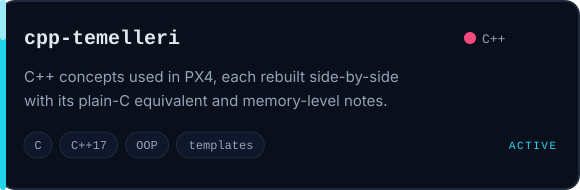
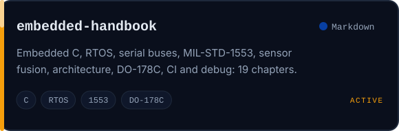
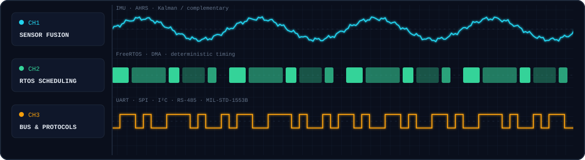

<!-- ============================================================
     Profile README — github.com/batuuhnk
     Visuals: /assets (generated by tools/gen_assets.py).
     Every image is wrapped in a link so nothing opens a bare SVG.
     ============================================================ -->

<p align="center">
  <a href="https://www.linkedin.com/in/batuhankilicli"></a>
</p>

<p align="center">
  <a href="https://www.linkedin.com/in/batuhankilicli"></a>
  <a href="mailto:batuhankilicli@gmail.com"></a>
  <a href="products.md"></a>
</p>

<p align="center">
  <b><a href="#featured-work">Featured work</a></b> &nbsp;·&nbsp;
  <b><a href="#what-i-build">What I build</a></b> &nbsp;·&nbsp;
  <b><a href="products.md">Products</a></b> &nbsp;·&nbsp;
  <b><a href="#journey">Journey</a></b> &nbsp;·&nbsp;
  <b><a href="#get-in-touch">Contact</a></b>
  <br />
  <sub>📍 Ankara, Türkiye</sub>
</p>

> [!TIP]
> **In 30 seconds:** embedded software engineer, **7 years** on firmware for **defense and avionics** products (AHRS, IMU, inclinometer, magnetic compass, air-data unit) on STM32 / Cortex-M with FreeRTOS, DO-178C-style process.
> Best place to start: **[cortex-m-sensor-fusion-benchmark](https://github.com/batuuhnk/cortex-m-sensor-fusion-benchmark)**, choosing a processor for sensor fusion before the hardware exists.

## Featured work

Click a card to open the repository, or jump straight to the most useful file with the links under it.

<p align="center">
  <a href="https://github.com/batuuhnk/cortex-m-sensor-fusion-benchmark"></a>
  <a href="https://github.com/batuuhnk/px4-sitl-learning"></a>
</p>

<table>
  <tr>
    <td width="50%">📄 <a href="https://github.com/batuuhnk/cortex-m-sensor-fusion-benchmark/blob/main/report/02-cortex-m33-study.md">Study report</a> &nbsp;·&nbsp; 📊 <a href="https://github.com/batuuhnk/cortex-m-sensor-fusion-benchmark/tree/main/results/cortex-m33-study">Results</a> &nbsp;·&nbsp; 🧭 <a href="https://github.com/batuuhnk/cortex-m-sensor-fusion-benchmark/blob/main/report/01-method.md">Method</a> &nbsp;·&nbsp; 💻 <a href="https://github.com/batuuhnk/cortex-m-sensor-fusion-benchmark/tree/main/code">Code</a></td>
    <td width="50%">🧩 <a href="https://github.com/batuuhnk/px4-sitl-learning/blob/main/docs/04-mimari-uorb.md">uORB architecture</a> &nbsp;·&nbsp; 🛠️ <a href="https://github.com/batuuhnk/px4-sitl-learning/blob/main/docs/06-modul-surucu-ve-mavlink.md">Own module &amp; baro driver</a> &nbsp;·&nbsp; 📉 <a href="https://github.com/batuuhnk/px4-sitl-learning/blob/main/docs/05-kontrol-ve-gps-kaybi.md">GPS-loss log analysis</a></td>
  </tr>
</table>

<p align="center">
  <a href="https://github.com/batuuhnk/cpp-temelleri"></a>
  <a href="https://github.com/batuuhnk/embedded-handbook"></a>
</p>

<table>
  <tr>
    <td width="50%">📚 <a href="https://github.com/batuuhnk/cpp-temelleri#dersler">All lessons</a> &nbsp;·&nbsp; 🚁 <a href="https://github.com/batuuhnk/cpp-temelleri/blob/main/10-bitirme/NOT.md">Final: mini PX4 work queue</a> &nbsp;·&nbsp; ⚡ <a href="https://github.com/batuuhnk/cpp-temelleri/blob/main/09-hizli-tekrar/NOT.md">One-page recap</a></td>
    <td width="50%">📖 <a href="https://github.com/batuuhnk/embedded-handbook#chapters">All 19 chapters</a> &nbsp;·&nbsp; 🧭 <a href="https://github.com/batuuhnk/embedded-handbook/blob/main/chapters/05-sensors-and-navigation.md">Sensors &amp; navigation</a> &nbsp;·&nbsp; 🛫 <a href="https://github.com/batuuhnk/embedded-handbook/blob/main/chapters/07-do-178c.md">DO-178C</a></td>
  </tr>
</table>

| Project | What it shows | Start here |
|---|---|---|
| [cortex-m-sensor-fusion-benchmark](https://github.com/batuuhnk/cortex-m-sensor-fusion-benchmark) | Sizing a processor for Kalman-filter workloads: measure on Cortex-M33, project onto M7 and DSP | [Study report](https://github.com/batuuhnk/cortex-m-sensor-fusion-benchmark/blob/main/report/02-cortex-m33-study.md) |
| [px4-sitl-learning](https://github.com/batuuhnk/px4-sitl-learning) | PX4 flight stack in simulation: uORB, a custom work-queue module, fault injection, ULog analysis | [Own module & baro driver](https://github.com/batuuhnk/px4-sitl-learning/blob/main/docs/06-modul-surucu-ve-mavlink.md) |
| [cpp-temelleri](https://github.com/batuuhnk/cpp-temelleri) | C → C++ for flight software, each concept in C and C++ side by side with its Cortex-M cost | [Mini PX4 work queue](https://github.com/batuuhnk/cpp-temelleri/blob/main/10-bitirme/NOT.md) |
| [embedded-handbook](https://github.com/batuuhnk/embedded-handbook) | Practical notes for real-time and safety-critical firmware | [Chapter list](https://github.com/batuuhnk/embedded-handbook#chapters) |

> [!NOTE]
> Most of my professional code ships inside certified products and can't be published. The repositories here are personal work and learning projects; the products themselves are listed in **[Products I've worked on](products.md)**.

## About

I'm an embedded software engineer with **7 years** of hands-on experience building firmware for **defense and avionics** systems — from bare-metal drivers and BSPs up to RTOS architectures, sensor fusion and the test tooling that proves it all works in the field.

```c
const engineer_t batuhan = {
    .role        = "Embedded Software Engineer",
    .domain      = { "Defense", "Avionics", "Navigation" },
    .platforms   = { "STM32", "ARM Cortex-M", "TI TMS" },
    .rtos        = "FreeRTOS / CMSIS-RTOS v2",
    .specialties = { "Sensor fusion", "DSP filtering", "Real-time DAQ", "Driver & BSP design" },
    .process     = { "DO-178C", "V-Model", "HIL / SIL testing" },
    .exploring   = "PX4 flight stack",
};
```

## What I build

<p align="center">
  <a href="https://github.com/batuuhnk/embedded-handbook"></a>
</p>

<table>
  <tr>
    <td width="33%" valign="top">
      <h4>🧭 Navigation &amp; sensing</h4>
      Inertial sensing and sensor fusion: Kalman and complementary filters, sensor calibration and digital filtering pipelines.
      <br /><br />→ <a href="https://github.com/batuuhnk/cortex-m-sensor-fusion-benchmark">Fusion benchmark</a> · <a href="https://github.com/batuuhnk/embedded-handbook/blob/main/chapters/05-sensors-and-navigation.md">Notes</a>
    </td>
    <td width="33%" valign="top">
      <h4>⏱️ Real-time architecture</h4>
      FreeRTOS task design, DMA-driven acquisition, deterministic timing, error logging and Built-In Test (BIT).
      <br /><br />→ <a href="https://github.com/batuuhnk/embedded-handbook/blob/main/chapters/02-rtos-and-concurrency.md">RTOS notes</a> · <a href="https://github.com/batuuhnk/embedded-handbook/blob/main/chapters/06-software-architecture.md">Architecture</a>
    </td>
    <td width="33%" valign="top">
      <h4>🧪 Verification &amp; tooling</h4>
      Requirements-based testing, HIL / SIL rigs, Qt test and calibration tools, DO-178C-style traceability.
      <br /><br />→ <a href="https://github.com/batuuhnk/embedded-handbook/blob/main/chapters/07-do-178c.md">DO-178C notes</a> · <a href="products.md#test-systems">Test systems</a>
    </td>
  </tr>
</table>

### Tech stack

| | |
|---|---|
| **Languages** | C · C++ · Python · MATLAB |
| **MCU & RTOS** | STM32 · ARM Cortex-M · TI TMS · FreeRTOS / CMSIS-RTOS v2 |
| **Buses** | UART · SPI · I²C · RS-485 · MIL-STD-1553B |
| **Tools** | Qt · Altium Designer · NI TestStand · Git |
| **Process** | DO-178C · V-Model · HIL / SIL |

## Journey

<p align="center">
  <a href="products.md"></a>
</p>

<p align="center"><sub>Click the timeline for the products behind each step.</sub></p>

## Currently

- 🛩️ &nbsp;Studying the **PX4 flight stack** in simulation — uORB, estimators, control loops and failure scenarios ([px4-sitl-learning](https://github.com/batuuhnk/px4-sitl-learning))
- 🔧 &nbsp;Bridging **C → modern C++** for flight-software codebases ([cpp-temelleri](https://github.com/batuuhnk/cpp-temelleri))
- 📊 &nbsp;Benchmarking **sensor-fusion workloads** on Cortex-M to size processors before hardware exists ([cortex-m-sensor-fusion-benchmark](https://github.com/batuuhnk/cortex-m-sensor-fusion-benchmark))

## Get in touch

Open to conversations about **embedded systems, navigation and avionics software**. The fastest way to reach me is [LinkedIn](https://www.linkedin.com/in/batuhankilicli) or [email](mailto:batuhankilicli@gmail.com).

<p align="center">
  <a href="https://www.linkedin.com/in/batuhankilicli"></a>
</p>
