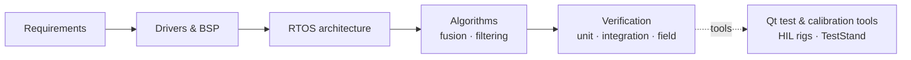

# Products I've Worked On

A high-level overview of the products I have built firmware and test systems for, and what my part was. Descriptions are kept at a general, public level — no performance figures, interfaces or internal design details. Product names are those used on the manufacturers' public websites.

[← Back to profile](README.md)

---

## 🧭 Navigation & Inertial Sensing

| Product | What it is | My contribution |
|---|---|---|
| **AHRS-10X** | Attitude and heading reference system — gives roll, pitch and heading from inertial and magnetic sensors | Full-stack firmware: platform-independent sensor drivers, RTOS task architecture, integration of sensor-fusion and filtering algorithms, unit-to-system verification |
| **MPN-10-IMU** | Inertial measurement unit — delivers raw angular rate and acceleration to a host navigation system | Modular driver architecture, RTOS scheduling, DMA-based real-time acquisition and synchronisation, filtering pipelines, lab and field evaluation |
| **ATS-10X** | Two-axis inclinometer — measures platform tilt | Full-stack firmware: drivers, RTOS architecture, digital filtering for tilt measurement |
| **ASMP-10X** | Military digital magnetic compass | Sensor drivers, RTOS-based software architecture, integration of model-generated algorithm code, automated test and validation setup |

## ✈️ Avionics

| Product | What it is | My contribution |
|---|---|---|
| **Static Port System** | Aviation pressure and temperature measurement unit | RTOS firmware on STM32: multi-sensor acquisition, built-in test and health monitoring, avionics serial protocol with in-field firmware update; unit, integration and field validation; desktop ground-support tool for hardware-in-the-loop testing and telemetry |
| **CSMU** | Crash-survivable memory unit — protected flight data storage | Technical coordination across mechanical, software, electronics and suppliers: planning, production-series and BOM tracking, configuration management, verification |

## 🎯 Weapon Systems

| Product | What it is | My contribution |
|---|---|---|
| **Gun-Pod Control Unit** | Control electronics for an aircraft gun pod, connected to the aircraft over MIL-STD-1553B | Took ownership of the existing control software; built functional test software for hardware-in-the-loop validation, led integration testing, resolved field-integration issues, produced formal test documentation |

## 🧪 Test Systems

| Product | What it is | My contribution |
|---|---|---|
| **Test program sets** | Automated test stations for defense electronic units — test boxes, cable-harness testers and adapter boards | Test hardware and PCB design, test firmware, test procedures and NI TestStand operator interfaces |

---

## Across all products

- **Platforms:** STM32 (ARM Cortex-M), TI TMS
- **Software:** C, FreeRTOS / CMSIS-RTOS v2, Qt
- **Process:** V-model, DO-178C-aligned lifecycle documentation

> Source code and internal documentation for these products belong to their manufacturers and are not published here.
